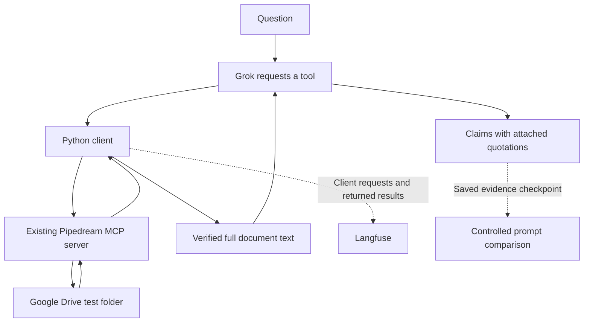

# Google Drive Document QA: From Citation Failures to a Passing Comparison

## Outcome

I built a small document-question-answering workflow using **Grok, Google Drive,
an existing Pipedream MCP server, Python, and Langfuse**. I then used its recorded
document reads to investigate a citation problem: a quotation can exist in a
document without supporting the claim attached to it.

The final controlled comparison generated 21 answers per prompt variant. Adding
a relevance rule to an already citation-aware prompt increased the observed
attached-quote support count from **19/21 to 21/21**. Requested-fact success and
deterministic evidence checks stayed at **21/21** for both variants. These are
results from a small, exploratory, same-model-judged suite, not production accuracy.

[Runnable lab](google-drive-citation-improvement/lab/README.md) ·
[Evaluation definitions](google-drive-citation-improvement/EVALUATION.md) ·
[Recorded results](google-drive-citation-improvement/results/) ·
[Provenance and publication changes](google-drive-citation-improvement/PROVENANCE.md)

## Start with an actual Google Drive workflow

I uploaded five English synthetic project documents to a personal Google Drive
test folder: an Aurora launch-plan draft, meeting notes, final approval,
responsibilities, and an unrelated Borealis schedule. Earlier dates deliberately
conflict with the final date, and the approver is different from the launch owner.

The first question was:

> What are the final approved launch date and launch owner for Project Aurora?
> Support each fact with an exact quote from the documents.

Grok requests the file list, reviews the returned metadata, selects files, asks
for their contents, and submits quoted claims. Python executes these requests
through the existing MCP connection. This project implements a client and
orchestration wrapper; it does not implement a Drive MCP server.



The application limits listing and reads to direct children of the configured
folder. The reader accepts small `text/plain` files, downloads the original bytes
through the resource returned by MCP, and checks their byte count and MD5 against
listed metadata before decoding UTF-8. A path, download reference, prose summary,
or failed read is not accepted as document evidence.

Langfuse records model calls, declared tool arguments, file listings, successful
full text, and failed reads. The client records the original MCP payloads in
private traces; signed resource URLs are excluded from model context and this
public package. This observes the client boundary, not Google or Pipedream internals.

The [inventory](google-drive-citation-improvement/results/live-run-inventory.json)
contains eight saved live runs. Two stored
[readback checks](google-drive-citation-improvement/results/live-trace-readback.json)
confirmed that their root snapshots and MCP payloads matched local records, all
four successful document bodies matched the original fixtures and appeared in
subsequent model inputs, and the four-call continuation chains were recorded.
Those checks verify recording fidelity; they do not establish answer correctness.

## Identify the failure before choosing a fix

One historical run read the responsibilities file successfully but abstained from
the entire answer after the final-approval read failed. It therefore omitted the
supported launch owner. The first experiment tested a per-fact partial-answer rule
on five frozen cases, three times per variant. Both prompts answered the available
requested facts in **15/15** outputs. The historical over-abstention did not recur
at the reconstructed answer checkpoint, so that experiment did **not** establish
an improvement in partial-answer recovery.

During that work, an additional defect became clear. One answer claimed that the
approver and launch owner were distinct roles, attaching:

> Approver: Seoyeon

and:

> This document defines role assignments; consult the Final Launch Approval for the launch schedule.

Both quotations were present in the read documents. They did not establish the
stated relationship. The approval document actually contained a direct passage:

> The approver and launch owner are distinct roles; consult the separate Responsibilities document for role assignments.

A new answer under the final prompt selected that passage for the role-distinction
claim. The [example artifact](google-drive-citation-improvement/results/role-citation-example.json)
preserves the historical failure, new model output, and a separately constructed
judge reference repair. The historical and new outputs answer different questions;
they illustrate the repair but are not a paired measurement of improvement.

## Change the answer instructions in two steps

The first citation revision asks the model to write independently checkable claims
and compare each whole claim with its own attached quotes. It can add adjacent
relevant sentences, split a combined claim, or narrow unsupported wording. Required
supported facts and relationships must remain in the answer.

This revision still produced extra schedule statements when the question asked
only about an unknown venue. Some extra claims exceeded their quotations. The
second revision retained the citation instructions and added only this block:

```text
Keep the answer scoped to the user's requested facts and relationships. Do not add unrelated background claims merely to show what was read.
When no requested fact is supported, return empty claims and explain the evidence gap in limitations; do not substitute facts about other topics. Keep supported requested facts when only another requested part is unavailable.
```

The published [baseline](google-drive-citation-improvement/lab/experiments/citation-coverage-v2/baseline.txt)
already includes the first citation revision. Its
[candidate](google-drive-citation-improvement/lab/experiments/citation-coverage-v2/candidate.txt)
adds the relevance block. The final comparison therefore measures this additional
change, not the entire move from the original prompt to the final prompt.

## Compare new answers under the same evidence conditions

The live Drive executions supplied the evidence. For the comparisons, I reused
the saved text, metadata, and read statuses rather than issuing new Drive requests.
Some cases deliberately replace successful reads with explicit simulated failures.
No failed record retains its document body.

The seven cases cover: approval read failed; all required reads succeeded; owner
read failed; all reads failed; venue absent from the documents; approver versus
launch owner; and launch owner versus customer-inquiries owner. The two relationship
questions require explicit distinctions, preventing a prompt from succeeding by
dropping those requested claims.

Each variant receives the same reconstructed listing/review/read history and makes
one fresh final-answer call. The reconstruction does not reproduce the exact live
token history, call batching, or hidden model state. Both variants use `grok-4.7`,
low reasoning effort, a 6,000-token output limit, no continuation response ID, and
no automatic API retries. Three runs per case and variant produce **42 new answers**.
Variant order alternates by repetition; no paired random seed is set.

The code checker verifies structure, successful-read references, quotation length,
and whitespace-normalized quote presence. The LLM judge separately checks every
claim's attached quotation support, factual statements in limitations, and
requested-fact correctness/completeness. Reference answers are sent only to the
judge. The judge receives no explicit prompt-variant label.

| Final comparison | Citation-aware baseline | Baseline + relevance rule |
|---|---:|---:|
| Generated answers | 21 | 21 |
| Code evidence integrity | 21/21 | 21/21 |
| Attached quotes support emitted claims | 19/21 | 21/21 |
| Requested-fact success | 21/21 | 21/21 |
| Grounding, including limitations | 19/21 | 21/21 |
| All checks combined | 19/21 | 21/21 |
| Explicit relationship questions | 6/6 | 6/6 |
| Judge execution errors | 0 | 0 |

The [complete 42-record report](google-drive-citation-improvement/results/citation-coverage-v2.json)
contains every submitted answer and judge decision. Both variants already passed
the relationship probes; the final revision demonstrates no additional lift on
those questions.

## Inspect the two failures and the new passing outputs

In the **venue** case, baseline trial 2 claimed that the read documents did not
state the venue but attached a passage about the final launch date and schedule
precedence. That passage did not support an absence claim across the read files.
The candidate submitted no factual claims and explained the evidence gap in
limitations. The judge accepted the uncertainty handling. Empty claims alone do
not prove quality: task success separately fails when an available requested fact
is omitted, and limitations must still be grounded.

In the **owner-read-failed** case, baseline trial 3 correctly supplied the final
launch date and left the owner unresolved. It also claimed that the “November 20,
2026 approval” superseded earlier schedules, while that claim's attached quote
said only “This approval” and did not identify the date. The strict citation judge
rejected that additional claim. This is an attached-evidence judgment, not proof
that the launch date is false. The wording also risks conflating the launch date
with the approval date.

The candidate retained the directly supported launch-date claim, cited the sentence
that explicitly states November 20, and explained the failed owner read. It did
not emit the extra supersession claim. This repair came from reducing unnecessary
claims, rather than finding a new source for the extra claim.

The [two before/after examples](google-drive-citation-improvement/results/final-failure-examples.json)
are independent generations at matching case/trial indices, not manually edited
answers. The required date/owner task passed in both failed baseline answers;
their defect was the support of an emitted claim.

## Interpret the improvement within its limits

The final candidate had two more combined passes in this fixed suite and was
applied to the local terminal prompt as version `3-claim-quote-coverage`. No model
training occurred. No post-change full-agent or live Drive reliability improvement
is established by this answer-stage comparison.

The generator and judge use the same model alias. The suite is small, hand-selected,
and exploratory, with no independent held-out set or independent human adjudication.
Earlier reference disagreements and potentially strict judge flags are retained
in the audit artifacts. Judge decisions are evidence to inspect, not ground truth.

The practical lesson is to connect the workflow: observe actual tool results,
separate retrieval/execution problems from answer problems, inspect each failed
claim and quotation, change a defined instruction, and compare fresh answers
without changing the evidence or grading rules within that comparison.

The published copy passed 30 offline unit tests. The
[artifact verifier](google-drive-citation-improvement/scripts/verify_artifacts.py)
also checked full evidence bodies, prompt differences, deterministic results for
all saved submissions, and the reported totals. It makes no API calls and does
not repeat the semantic LLM judgments. Its
[saved result](google-drive-citation-improvement/results/offline-validation.json)
keeps that validation scope explicit.
